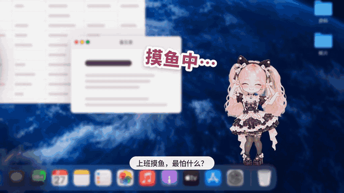
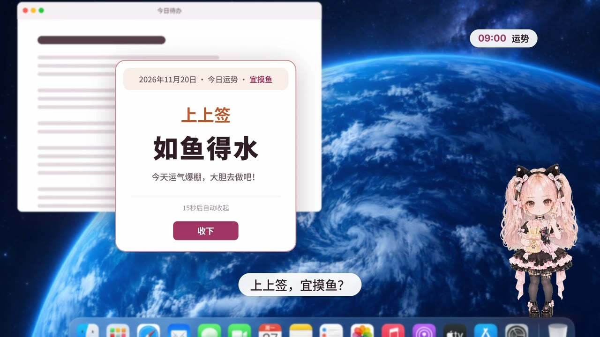
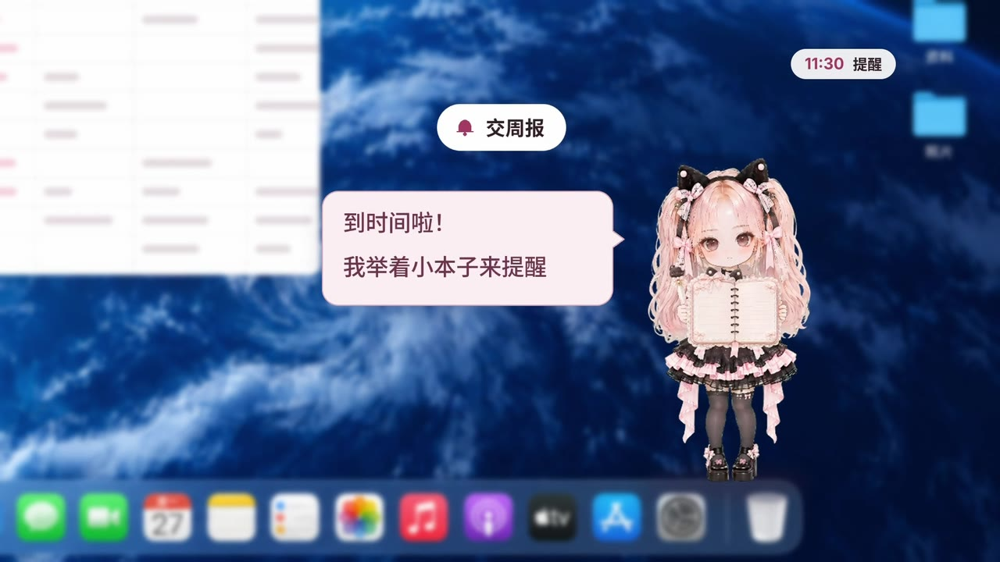
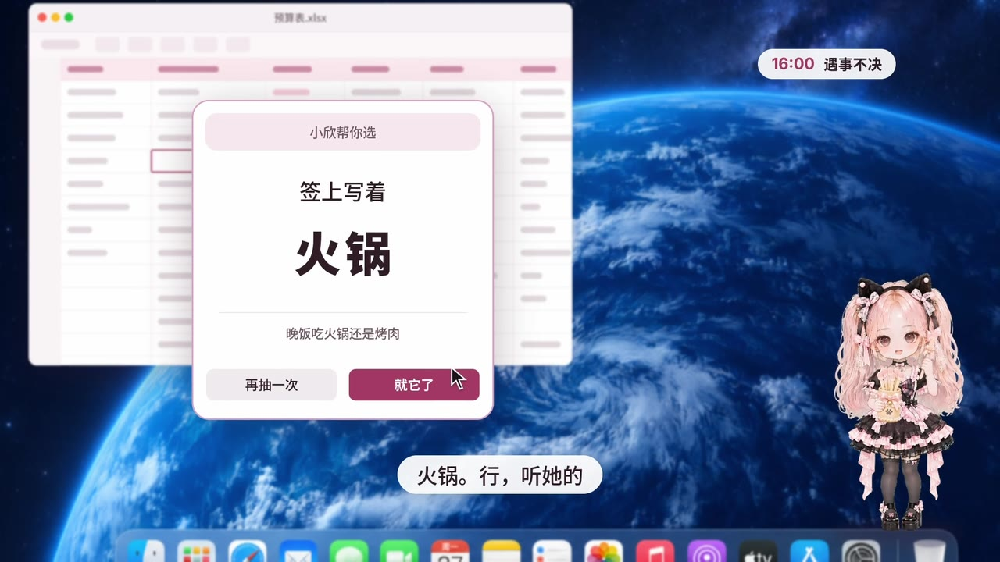
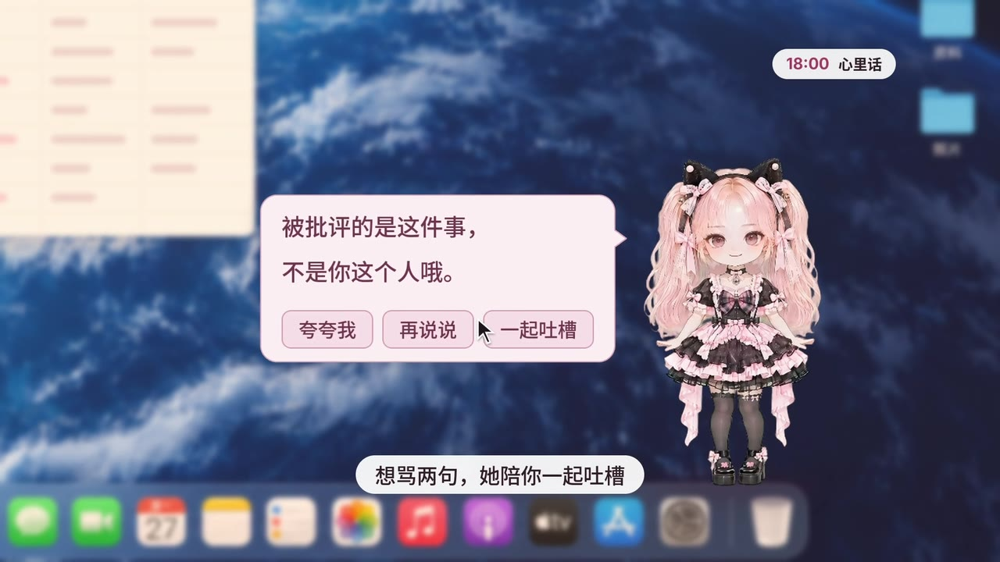
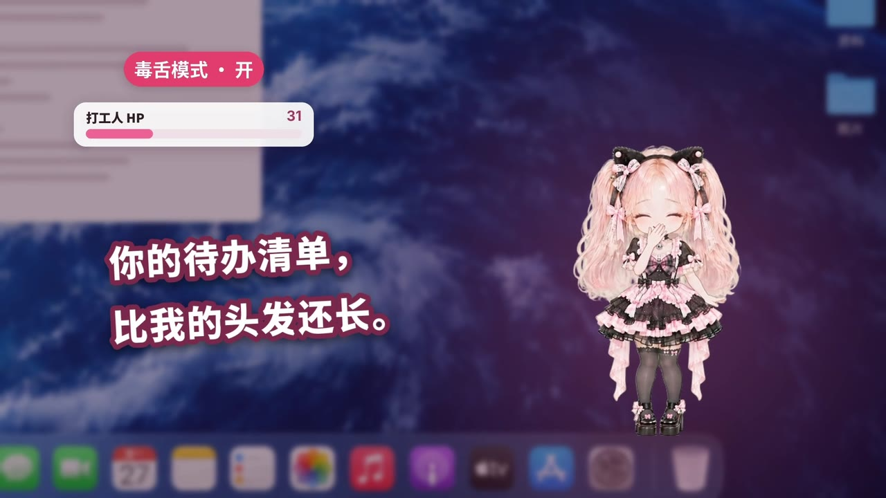
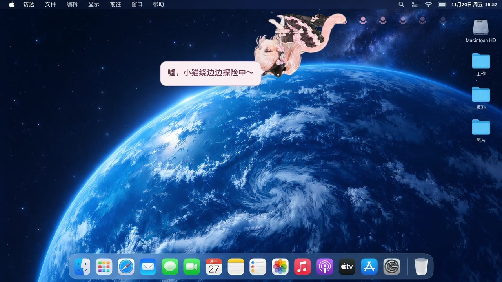
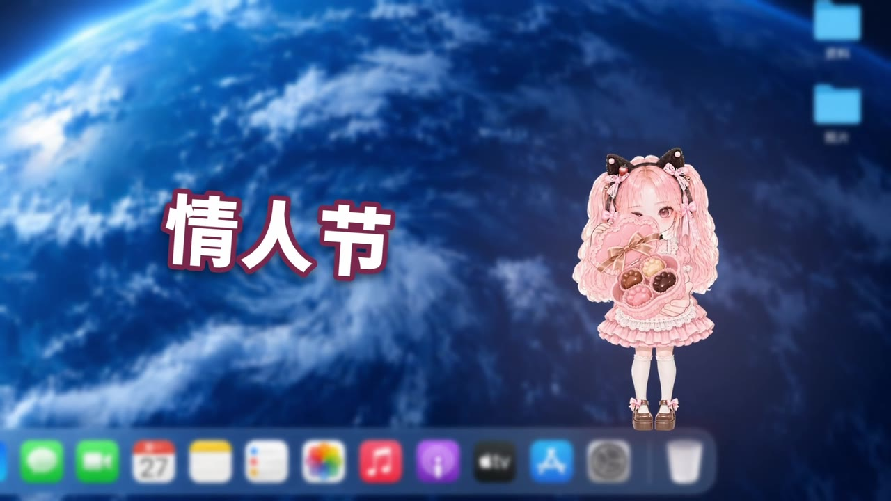

# 小欣 · 你的职场搭子

一只住在 Mac 桌面上的小猫系桌宠。 
她不会替你上班，但会陪你上班。

**[⬇️ 下载小欣](https://github.com/xiaopengwang37-debug/xiaoxin-desktop-pet/releases/latest)** ·
**[▶️ 看宣传片（2 分半）](https://github.com/xiaopengwang37-debug/xiaoxin-desktop-pet/releases/latest)**

---

## 她能做什么

| | |
|---|---|
| **一秒消失** 老板来了？连按两下 Option，她立刻变成一个泡泡。 |  |
| **每日运势** 早上开机摇一摇，抽一支今天的签。 |  |
| **录音** 开会记不过来？右键点她，开始录音。录音存在「文稿 / 小欣录音」里。 | |
| **提醒** 双击她，用大白话打字：“下午三点提醒我交周报”。她会记在小本子上，到点叫你。还会提醒你喝水、起来活动。 |  |
| **摸鱼小游戏** 猜铃铛、逗猫红点……输了她还会嘴硬。 | |
| **遇事不决** “晚饭吃火锅还是烤肉？”交给她选。 |  |
| **心里话** 被领导说了，想骂两句，她陪你一起吐槽；想听好话，她就夸你。你说的每一句，她都不会存。 |  |
| **毒舌模式** 打开以后，她嘴上一点不饶人。 |  |
| **到处溜达** 你忙完了，她会自己走来走去，走到屏幕边上，还能贴着边爬一圈。也可以把她拎起来扔出去。 |  |
| **生日和节日** 记得你的生日；圣诞、春节、情人节还会换上新衣服。 |   |
| **一起慢慢变熟** 相处越久越亲近，从“初见的小猫”到“无话不说”。一路解锁小饰品，还能生成分享卡晒晒你们的交情。 |  |

她的名字也可以改，你想叫她什么都行。

## 下载和安装

1. 打开 **[Releases 下载页](https://github.com/xiaopengwang37-debug/xiaoxin-desktop-pet/releases/latest)**，下载 `小欣-…-macOS.zip`。
2. 双击解压，把「小欣.app」拖进「应用程序」文件夹。
3. **第一次打开**：因为还没有经过 Apple 公证，直接双击会提示“无法验证开发者”。这样打开：
   - 在「应用程序」里**右键点「小欣」→ 打开**，在弹出的窗口里再点一次「打开」；
   - 如果还是打不开：打开「系统设置 → 隐私与安全性」，拉到下面，点「仍要打开」。
   
   只需要这样做一次，以后正常双击就行。
4. 菜单栏出现小爪印，就说明她来了。所有功能都在爪印菜单里，或者右键点她。

**系统要求**：macOS 13 或更新版本，Apple 芯片（M 系列）的 Mac。

## 隐私

- 除了天气和城市查询，小欣不联网。
- 心里话里你说的话不保存。
- 录音只在你点“开始录音”后才开始，文件只存在你自己的 Mac 上。
- 设定、陪伴天数等记录都只存在这台 Mac 上，没有云同步。

## 关于

小欣的原型，是我的剧集里的角色「小AI」。最近剧集没更新，就是在忙这个 🙈

策划用的是 Claude，代码由 Codex 写，Gemini 也提了不少意见。

有问题或者建议，欢迎在 [Issues](https://github.com/xiaopengwang37-debug/xiaoxin-desktop-pet/issues) 里留言。

使用的公共数据（中国、日本节假日表等）的许可说明见应用内的 `ThirdPartyNotices.txt`。

© 2026 小欣桌宠作者。保留所有权利。欢迎免费下载使用；未经许可，请勿二次分发或商用。
